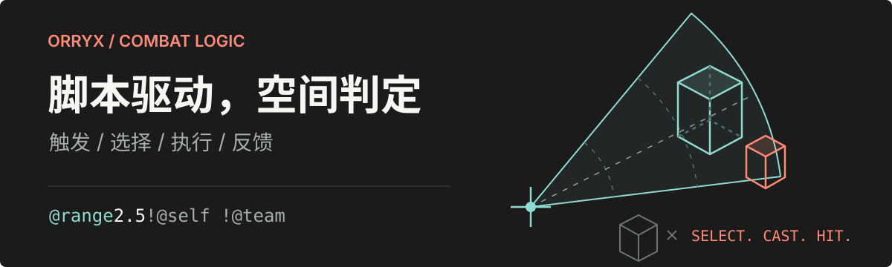

<p align="center">
  
</p>

<p align="center">
  <strong>Minecraft 技能插件 · YAML 配置 · Kether 脚本 · Kotlin / Java API</strong>
</p>

<p align="center">
  <a href="https://github.com/zhibeigg/Orryx/releases"></a>
  <a href="https://kotlinlang.org/"></a>
  <a href="LICENSE"></a>
</p>

<p align="center">
  <a href="#快速开始">快速开始</a> ·
  <a href="https://o0vvjwgpeju.feishu.cn/wiki/Syzzw7aQwixJ4YkXoOAcyYkfnOg">使用指南</a> ·
  <a href="https://zhibeigg.github.io/Orryx/">Kether 文档</a> ·
  <a href="docs/API.md">开发者 API</a>
</p>

**Orryx** 面向 Minecraft RPG 服务器的服主、技能作者与插件开发者。用 YAML 定义技能和职业，用 Kether 编排触发条件、目标选择、伤害与特效，再连接服务器已有的属性、怪物和客户端 UI 系统。

## 从脚本到技能

一次冲刺可以由多段范围伤害组成。下面节选自仓库内的 [「裂焱冲击」完整配置](src/main/resources/skills/裂焱冲击-AI生成案例.yml)：每隔 2 tick 检测一次目标，连续执行 5 次，排除自身、盔甲架和队友。

```yaml
Options:
  Type: "DIRECT"
  Name: "裂焱冲击"
  Variables:
    DAMAGE: |-
      calc "20+3*(level-1)"
Actions: |-
  for i in range 1 to 5 then {
    sleep 2
    damage lazy *DAMAGE false they "@range 2.5 !@self !@type ARMOR_STAND !@team" source "@self" type FIRE
  }
```

`!@team` 使用 DungeonPlus 队伍信息，需要启用对应插件；没有队伍系统时可移除此过滤器。

**触发 → 选择目标 → 执行动作 → 呈现反馈**。技能、事件中转站与状态控制器共用 Kether，范围选择器和碰撞系统负责目标判定，粒子、动画和 UI 负责反馈。

<p align="center">
  
</p>

| 你要构建的内容 | Orryx 提供的能力 |
| --- | --- |
| 技能与职业成长 | 被动、直接、指向、蓄力、蓄力指向；技能组、等级、技能点、法力与精力 |
| 有空间感的战斗 | 扇形、环形、射线等选择器；球体、胶囊体、AABB、OBB 与复合碰撞体 |
| 事件驱动的机制 | Bukkit、Orryx 和第三方事件触发；眩晕、格挡、闪避及技能状态管理 |
| 与现有服务器联动 | 属性伤害、MythicMobs 技能、DungeonPlus 副本、占位符与虚拟实体 |
| 多端交互 | Bukkit 原生界面，以及 DragonCore、GermPlugin、ArcartX UI 与动画桥接 |

选择器、动作、触发器和各插件桥接能力见 [功能与集成参考](docs/Features.md)。

## 快速开始

### 1. 安装插件

1. 从 [Releases](https://github.com/zhibeigg/Orryx/releases) 下载发行包，放入服务器的 `plugins/` 目录。
2. 重启服务器，等待生成 `plugins/Orryx/` 配置。
3. 保持默认 **Bukkit UI + SQLite** 即可开始；按需要编辑 `config.yml`。

TabooLib 由插件集成，无需单独安装；客户端引擎、属性插件和 Redis 为按需集成项。运行 Java 版本应满足所选 Minecraft 服务端的要求，第三方插件与客户端 Mod 的版本需另行匹配。

### 2. 运行第一个技能

新建 `plugins/Orryx/skills/hello.yml`：

```yaml
Options:
  Type: "DIRECT"
  Name: "Hello Orryx"
Actions: |-
  tell "Hello Orryx"
```

由具有管理权限的玩家在游戏内执行，将 `<玩家名>` 替换为在线玩家的名字：

```text
/or reload
/or skill cast <玩家名> hello 1 false
```

目标玩家应收到 `Hello Orryx`。这里的 `hello` 是配置文件名；`false` 表示直接释放，跳过冷却、法力等条件检查，适合验证脚本。

### 3. 组合职业与界面

参考 [职业模板](src/main/resources/jobs/example.yml)，在 `Options.Skills` 中填入技能文件名，将技能加入职业。仓库自带的 `example` 职业可用于体验默认界面：

```text
/or job change <玩家名> example
/or ui openUI <玩家名> <玩家名>
```

两个 UI 参数分别是技能所属玩家与查看界面的玩家。更多配置与命令见 [使用指南](https://o0vvjwgpeju.feishu.cn/wiki/Syzzw7aQwixJ4YkXoOAcyYkfnOg)。

<details>
<summary><strong>配置目录与存储选项</strong></summary>

```text
plugins/Orryx/
├── config.yml         # 主配置：数据库、UI、缓存、编辑器
├── keys.yml           # 按键与组合键
├── skills/            # 技能
├── jobs/              # 职业与技能组
├── stations/          # 事件中转站
├── controllers/       # 控制器
├── status/            # 状态
├── experiences/       # 经验算法
├── selectors.yml      # 选择器预设
├── state.yml          # 战斗状态机
├── ui/                # 各端界面
├── placeholders/      # 自定义占位符
└── lang/              # 语言文件
```

存储支持 SQLite（默认）、MySQL 与 H2；RedisChannel 提供可选的跨服缓存。`bloom.yml`、`buffs.yml`、`npc.yml` 分别配置泛光、Buff 与 NPC。完整默认值见 [资源模板](src/main/resources)。

切换数据库类型、UI 端或跨服缓存后需要重启服务器。

</details>

## 接入你的服务器

| 集成方向 | 可连接的插件 |
| --- | --- |
| 客户端与表现 | DragonCore、GermPlugin、ArcartX、CloudPick |
| 属性与战斗 | AttributePlus、Nodens、AstraXHero |
| 怪物与副本 | MythicMobs、DungeonPlus |
| 虚拟实体 | Adyeshach |
| 占位符与 HUD | PlaceholderAPI、GDDTitle |
| 协议与缓存 | PacketEvents、ProtocolLib、RedisChannel |

各桥接支持的功能不同，详见 [集成参考](docs/Features.md) 与 [客户端引擎集成](docs/Client-Engine-Integration.md)。配合 OrryxMod，`colliderShow` 可实时显示碰撞线框，协议见 [客户端集成文档](docs/Plugin-Integration.md)。

### 在线编辑器

在 `config.yml` 中配置 `Editor.License` 后，具有 `Orryx.Command.Editor` 权限的玩家可执行 `/orryx edit`，获取有效期 5 分钟的一次性入口；控制台可执行 `or edit` 获取网址。

License 用于中心身份校验，空值、被禁用或绑定 IP 不匹配时无法连接；License 到期不影响实时编辑器。连接方式与部署要求见 [编辑器文档](docs/Editor.md)。

### Agent SKILL 套件

[Orryx Creation Suite](agent-skills/orryx-creation-suite/README.md) 提供技能、Kether、职业、经验、中转站、状态机、选择器与 UI 的生成和校验流程，支持 Codex、Claude Code 与 Copilot。

```text
/orryx-ability-authoring-skill 创建一个蓄力技能
/orryx-workflow-orchestrator-skill 创建完整职业套件
```

安装方式与 Python 依赖见 [套件说明](agent-skills/orryx-creation-suite/README.md#安装)。

## 开发与构建

### 调用 API

```kotlin
repositories {
    maven("https://maven.mcwar.cn/releases")
}

val orryxVersion: String by project

dependencies {
    compileOnly("org.gitee.orryx:orryx:$orryxVersion:api")
}
```

在使用方的 `gradle.properties` 中设置 `orryxVersion`，选择与服务器一致的 [已发布 Maven 版本](https://maven.mcwar.cn/releases/org/gitee/orryx/orryx/maven-metadata.xml)。源码版本可能尚未发布，必要时可按下文生成 API 包。

通过 `Orryx.api()` 获取技能、职业、档案、按键和重载等接口：

```kotlin
import org.gitee.orryx.api.Orryx

// 走完整条件检查，尝试释放玩家拥有的技能
Orryx.api().skillAPI.tryCastSkill(player, "hello")

// 直接执行指定等级的技能，跳过冷却、法力等检查
Orryx.api().skillAPI.castSkill(player, "hello", 1)
```

公开接口与事件用法见 [API 文档](docs/API.md)。

### 从源码构建

与 CI 一致，使用 **JDK 21 运行 Gradle，并提供 JDK 8 编译工具链**。构建检查还需要 Python 3.10+，Windows 应可执行 `py -3`，其他系统应可执行 `python3`。项目依赖包含 `libs/` 下的本地 JAR。

```bash
# 构建发行包，输出到本仓库 build 目录
./gradlew build -Pbuild=./build

# 生成 API 包
./gradlew taboolibBuildApi -PDeleteCode -Pbuild=./build

# 生成 API 文档
./gradlew dokkaHtml

# 启动临时 Paper 并生成 Kether 文档
./gradlew generateKetherDocs
```

Windows PowerShell 使用 `./gradlew.bat`。文档生成会启动 Paper 1.21.1，发布与校验方式见 [Kether 文档发布协议](docs/Kether-Docs-Publishing.md)。

<details>
<summary><strong>源码导航与版本规则</strong></summary>

| 路径 | 内容 |
| --- | --- |
| [`src/main/kotlin/org/gitee/orryx/api`](src/main/kotlin/org/gitee/orryx/api) | 公开接口、事件与碰撞系统 |
| [`src/main/kotlin/org/gitee/orryx/core`](src/main/kotlin/org/gitee/orryx/core) | 技能、职业、Kether、选择器与中转站 |
| [`src/main/kotlin/org/gitee/orryx/module`](src/main/kotlin/org/gitee/orryx/module) | UI、状态、编辑器与文档生成 |
| [`src/main/kotlin/org/gitee/orryx/compat`](src/main/kotlin/org/gitee/orryx/compat) | 第三方插件桥接 |
| [`src/main/resources`](src/main/resources) | 默认配置与 UI 模板 |
| [`docs`](docs) | API、协议与集成文档 |

版本格式为 `A.B.C`：`A` 表示不兼容的 API 变动，`B` 表示功能更新，`C` 表示修复。

</details>

## 文档导航

| 你想了解 | 从这里开始 |
| --- | --- |
| 安装、配置与技能编写 | [飞书 Wiki](https://o0vvjwgpeju.feishu.cn/wiki/Syzzw7aQwixJ4YkXoOAcyYkfnOg) · [功能参考](docs/Features.md) |
| Kether 语法与动作 | [在线文档](https://zhibeigg.github.io/Orryx/) · [最新 Markdown](https://zhibeigg.github.io/Orryx/kether/latest.md) |
| 编辑器与文档工具接入 | [Registry v4](https://zhibeigg.github.io/Orryx/kether/kether-registry.json) · [Schema v3](https://zhibeigg.github.io/Orryx/kether/actions-schema.json) · [Manifest](https://zhibeigg.github.io/Orryx/kether/manifest.json) |
| 插件开发与实体操作 | [API](docs/API.md) · [实体字段](docs/EntityField.md) |
| 客户端协议与 UI | [OrryxMod 协议](docs/Plugin-Integration.md) · [客户端引擎](docs/Client-Engine-Integration.md) |
| AI 辅助阅读源码 | [DeepWiki](https://deepwiki.com/zhibeigg/Orryx) · [ZRead](https://zread.ai/zhibeigg/Orryx) |

## 特别鸣谢

<a href="https://www.poke2api.com"></a>

感谢 [Poke API](https://www.poke2api.com) 对本项目的支持。Poke API 提供 AI API 中继服务，支持 Claude、GPT 及 Claude Code、Codex、Gemini 等模型与开发工具生态。

<details>
<summary>使用统计</summary>

[](https://bstats.org/plugin/bukkit/Orryx/24289/)

</details>

---

基于 [TabooLib](https://github.com/TabooLib/taboolib) 构建 · [CC0 1.0 Universal](LICENSE) · Orryx © 2024–2026
